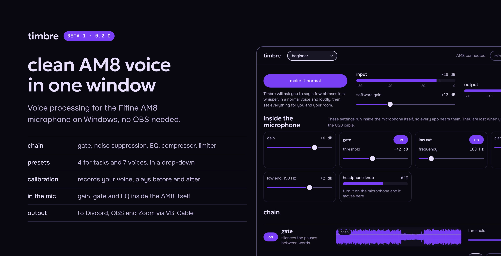
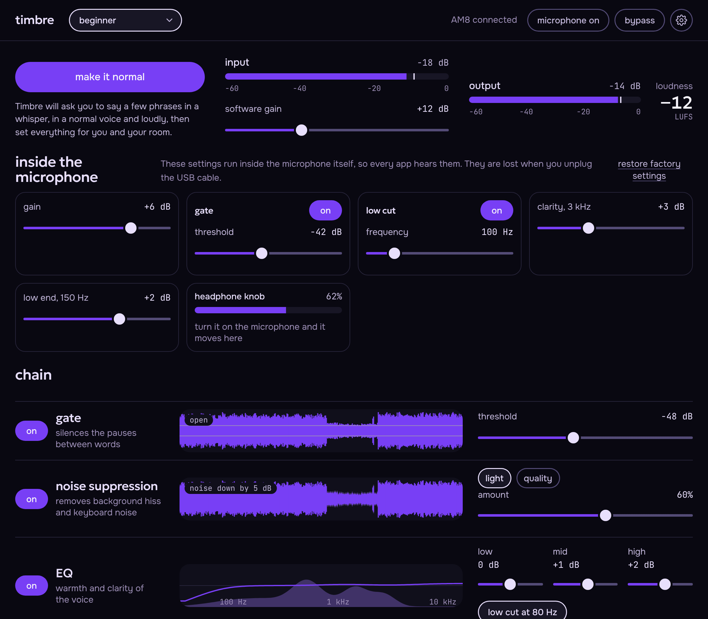
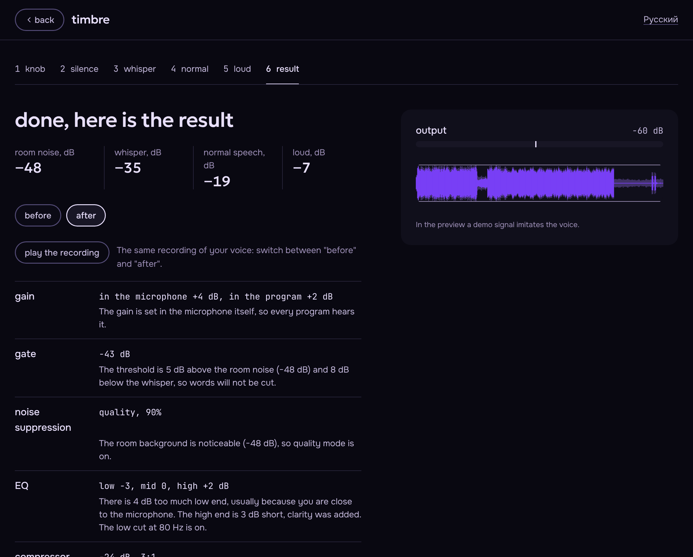

<p align="right">English · <a href="README.ru.md">Русский</a></p>

<p align="center">
  
</p>

**Timbre** puts the voice processing for the Fifine AM8 microphone into one window on Windows: the microphone's own gain, gate and EQ, then noise suppression, compressor and limiter in the program, presets for streaming, voice-over and calls, and a calibration wizard that sets everything from your voice and your room. The processed sound goes to Discord, OBS and Zoom through a virtual cable, so you do not need to run OBS just to clean up your microphone.

## Why

The AM8 has no software of its own. Gain, mute and lighting live on the body of the microphone, and everything else, from a gate to a compressor, has to be wired up by hand in OBS or Voicemeeter, which is where beginners get lost. Timbre replaces that setup with one window where every step shows its signal live and has a plain name, and one button, "make it normal", that picks the values for you.

## Features

- **Inside the microphone (new in 0.2).** The AM8 has its own signal processor, and Timbre talks to it over its USB control channel: gain, noise gate, low cut, clarity and a low shelf, shown on the main screen. These settings work in every program, with or without the virtual cable. The headphone knob on the body is read live. Every write is read back and checked.
- **Processing chain.** Gate, noise suppression (RNNoise), EQ, compressor and limiter. Every lane draws the signal after that step against the original one.
- **Presets in a drop-down.** Four task presets (beginner, stream, voice-over, call), your own "mine", and seven voices: warm broadcast, deep, bright podcast, thick, radio, robot and high. Any slider can be adjusted by hand, and "restore preset" undoes the changes.
- **Voice character.** A pitch shifter, warmth (soft saturation), thickness (chorus), a radio band and a robot ring modulator, all in one lane and all with sliders.
- **Software gain.** The AM8 is a dynamic microphone and quiet, so Timbre adds the missing level itself, up to +36 dB. The calibration works it out.
- **Calibration wizard.** Six steps: level check, room silence, whisper, normal speech, loud speech, result. It records your real takes, puts the gain into the microphone and plays "before" and "after" on the same recording so you can hear the change. Every value in the result is explained.
- **Runs in the background.** Tray icon, autostart with Windows, a global hotkey for mute, and a one-click bypass.
- **Output to your apps.** Sound goes into the VB-Cable virtual cable. In Discord, OBS or Zoom you pick `CABLE Output` as the microphone.
- **English and Russian.** The interface follows the system language and can be switched in the settings, on the first-run screen and in the wizard. The tray menu follows too.
- **Small and local.** The installer is about 2 MB and the noise model about 85 KB. Audio is processed on your computer and nothing is sent over the network.

## Screenshots

The screenshots were taken on a demo signal, so the numbers only show what the interface looks like.





## Install

1. Install [VB-Cable](https://vb-audio.com/Cable/) and restart the computer.
2. Download `Timbre_*_x64-setup.exe` from the [latest release](../../releases/latest) (pre-releases are under [Releases](../../releases)).
3. Run `Timbre_*_x64-setup.exe`. It does not need administrator rights. SmartScreen warns about an unknown publisher because the installer is not signed yet: click "More info", then "Run anyway".
4. In Discord, OBS or Zoom choose `CABLE Output` as the microphone, and in Timbre press the big button.

## Status: beta 1 (0.2.0)

The core is covered by tests on a synthetic signal, the app builds for Windows on GitHub Actions, and it has been tried on one real AM8. Expect rough edges:

- Settings inside the microphone live in its memory: they survive closing Timbre and are lost when the USB cable is unplugged. The mute button and the RGB lighting of the AM8 are not controlled by the program on purpose or because the firmware does not allow it.
- The analog gain knob cannot be read by software, only the headphone knob can.
- Noise suppression has been judged on few real voices. The "quality" mode currently uses the same RNNoise, and DeepFilterNet is planned.
- The target curve for automatic EQ is a first guess, tuned on real voices over time (`src/js/native.js`, constants `TARGET` and `CAUTION`).
- Pitch shifting is a simple granular shifter: fine for ±5 semitones, with some warble beyond that.
- Loudness is shown in LUFS without calibrating the signal path, as a guide only.

If something breaks, open Settings, press "copy the report" and paste it into the issue. The report lists the audio devices and, for the AM8, a read-only dump of its USB control interfaces and its current internal settings.

## Typography

Three families, two weights and one scale, so every level of the interface reads at a glance. Sizes follow a 1.2 scale from the 16 px body, weights are 400 and 500 only, and measured values (dB, Hz) are always monospaced.

| Role | Size | Font | Used for |
| --- | --- | --- | --- |
| Display | 33 px | Geologica 500 | page and wizard titles |
| Figure | 28 px | Geologica 500 | the one big number, loudness |
| Title | 23 px | Geologica 500 | section titles, quoted phrases, result figures |
| Section | 19 px | Geologica 500 | lane and step titles, the wordmark |
| Body | 16 px | Onest 400, 500 | text, verdicts, buttons |
| Label | 14 px | Onest 400, 500 | hints, field labels, pills |
| Micro | 12 px | JetBrains Mono 400 | scales, lane stats, units |

The roles live in `src/tokens.css` as `--fs-*`. The banner follows the same idea on a 1.25 scale: 61 px title, 31 px wordmark, 25 px lead and 20 px text.

## Build from source

You need Rust, Node 22 and, on Windows, the Visual Studio Build Tools.

```
npm ci
cargo test -p timbre-dsp --release
npm run build
```

The installer appears in `target/release/bundle/nsis`. On GitHub the same steps run from `.github/workflows/build.yml` on every push to `main`.

## Repository layout

| Folder | What is inside |
| --- | --- |
| `crates/timbre-dsp` | The processing chain in Rust, independent of the window, with 18 tests |
| `src-tauri` | The Tauri app: capture (cpal, WASAPI), output to the cable, tray, hotkey, autostart, and `am8.rs`, the allow-listed channel to the microphone's own processor |
| `src` | The interface in HTML, CSS and JS. Outside Tauri it runs on a demo signal, inside Tauri `js/native.js` connects the real engine |
| `preview` | The interface as single files for a browser, built with `node build-preview.mjs` |
| `docs` | The banners and screenshots for the READMEs, banner sources in HTML |

## Licenses

The fonts Geologica, Onest and JetBrains Mono are under the SIL OFL. The RNNoise noise suppressor comes through the `nnnoiseless` crate (BSD-3-Clause). The control protocol of the AM8 (MVsilicon ACP over the vendor HID interface) was worked out by [Austrum-lab/fifine-am8](https://github.com/Austrum-lab/fifine-am8) (MIT), with background from [dank0i/sc3](https://github.com/dank0i/sc3); Timbre has its own implementation and only uses the read and parameter-write commands they document as safe. VB-Cable is installed by the user separately under VB-Audio terms. The project's own license has not been chosen yet.
