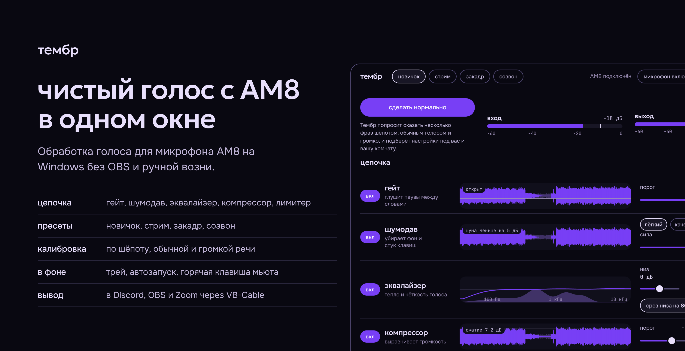
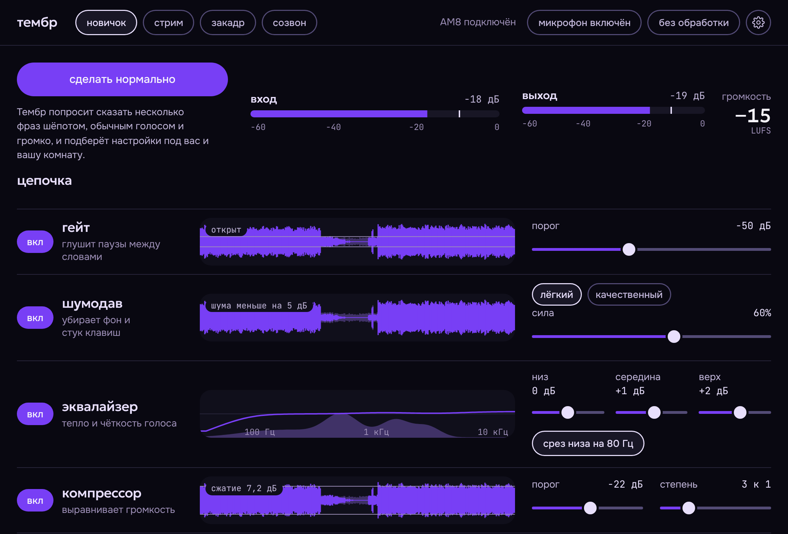
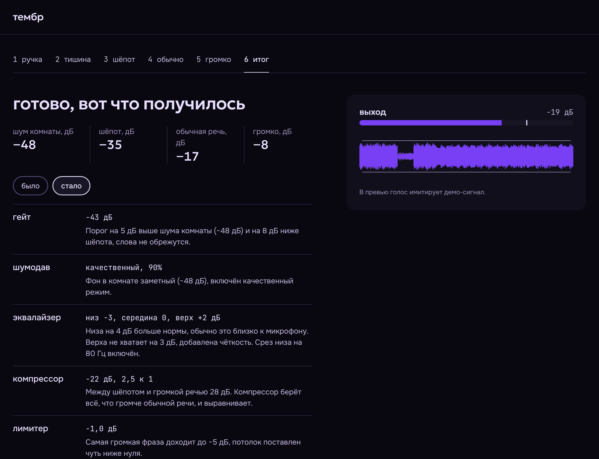

<p align="right"><a href="README.md">English</a> · Русский</p>

<p align="center">
  
</p>

**тембр** собирает звук микрофона Fifine AM8 в одном окне на Windows: гейт, шумодав, эквалайзер, компрессор и лимитер, пресеты под стрим, закадр и созвон, а также мастер калибровки, который подбирает настройки по вашему голосу и комнате. Обработанный звук уходит в Discord, OBS и Zoom через виртуальный кабель, запускать OBS ради этого не нужно.

*Voice chain for the Fifine AM8 microphone on Windows: gate, noise suppression, EQ, compressor, limiter, presets and a calibration wizard. Alpha.*

## Зачем это нужно

У AM8 нет собственного софта. Усиление, мьют и подсветка живут на корпусе, а всё остальное, от гейта до компрессора, приходится собирать вручную в OBS или Voicemeeter, и новичок в этом теряется. Тембр заменяет эту сборку одним окном, где у каждого шага есть живая картинка сигнала и понятное название, а «сделать нормально» подбирает значения за вас.

## Что умеет

- **Цепочка обработки.** Гейт, шумодав на RNNoise, эквалайзер, компрессор, лимитер. На каждой дорожке видно сигнал после этого шага на фоне исходного.
- **Пресеты.** «Новичок», «стрим», «закадр», «созвон» и ваш собственный «мой». Любой ползунок можно поправить руками, а «вернуть пресет» откатывает правки.
- **Мастер калибровки.** Шесть шагов: ручка усиления, тишина в комнате, шёпот, обычная речь, громко, итог. Каждое значение в итоге объяснено, а переключатель «было / стало» позволяет сравнить.
- **Работает в фоне.** Иконка в трее, автозапуск вместе с Windows, глобальная горячая клавиша для мьюта, «без обработки» одним нажатием.
- **Вывод в программы.** Звук идёт в виртуальный кабель VB-Cable, в Discord, OBS или Zoom выбирается `CABLE Output`.
- **Лёгкий и локальный.** Установщик около 2 МБ, модель шумодава около 85 КБ. Звук обрабатывается на компьютере, в сеть ничего не отправляется.

## Как это выглядит

Скриншоты сняты на демо-сигнале, поэтому цифры на них только показывают, как выглядит интерфейс.





## Установка

1. Поставьте [VB-Cable](https://vb-audio.com/Cable/) и перезагрузите компьютер.
2. Скачайте установщик: вкладка **Actions**, последняя успешная сборка `windows-installer`, раздел **Artifacts**, `timbre-windows-installer`.
3. Запустите `Timbre_*_x64-setup.exe`. Установщик не требует прав администратора. SmartScreen предупредит о неизвестном издателе: «Подробнее», «Выполнить в любом случае», потому что установщик пока без подписи.
4. В Discord, OBS или Zoom выберите микрофоном `CABLE Output`, в тембре нажмите «сделать нормально».

## Статус: альфа

Ядро покрыто тестами на синтетическом сигнале, приложение собирается под Windows на GitHub Actions. Живой звук с AM8 пока никто не слушал, поэтому ожидаемы шероховатости:

- Захват AM8 и вывод в кабель могут не открыться на нестандартных форматах устройства. Причина показывается в настройках под выбором устройств.
- Подавление шума проверено только на синтетике, на реальной речи его нужно оценить ушами. Режим «качественный» пока использует тот же RNNoise, подключение DeepFilterNet запланировано.
- Целевая кривая для автонастройки эквалайзера прикидочная и подбирается на живых голосах (`src/js/native.js`, константы `TARGET` и `CAUTION`).
- Громкость показывается в LUFS без калибровки тракта, как ориентир.

Нашли проблему, приложите текст ошибки из настроек или лог сборки.

## Сборка из исходников

Нужны Rust, Node 22 и на Windows Visual Studio Build Tools.

```
npm ci
cargo test -p timbre-dsp --release
npm run build
```

Установщик появится в `target/release/bundle/nsis`. На GitHub то же самое делает `.github/workflows/build.yml` при каждом пуше в `main`.

## Устройство репозитория

| Папка | Что внутри |
| --- | --- |
| `crates/timbre-dsp` | Цепочка обработки на Rust без привязки к окну, 11 тестов |
| `src-tauri` | Приложение на Tauri: захват (cpal, WASAPI), вывод в кабель, трей, горячая клавиша, автозапуск |
| `src` | Интерфейс на HTML, CSS и JS. Вне Tauri работает на демо-сигнале, внутри `js/native.js` подключает реальный движок |
| `preview` | Интерфейс одним файлом для просмотра в браузере, собирается `node build-preview.mjs` |
| `docs` | Баннер и скриншоты для этого README |

## Лицензии

Шрифты Geologica, Onest и JetBrains Mono распространяются по SIL OFL. Шумодав RNNoise подключён через крейт `nnnoiseless`. VB-Cable устанавливается пользователем отдельно по условиям VB-Audio. Лицензия самого проекта пока не выбрана.
