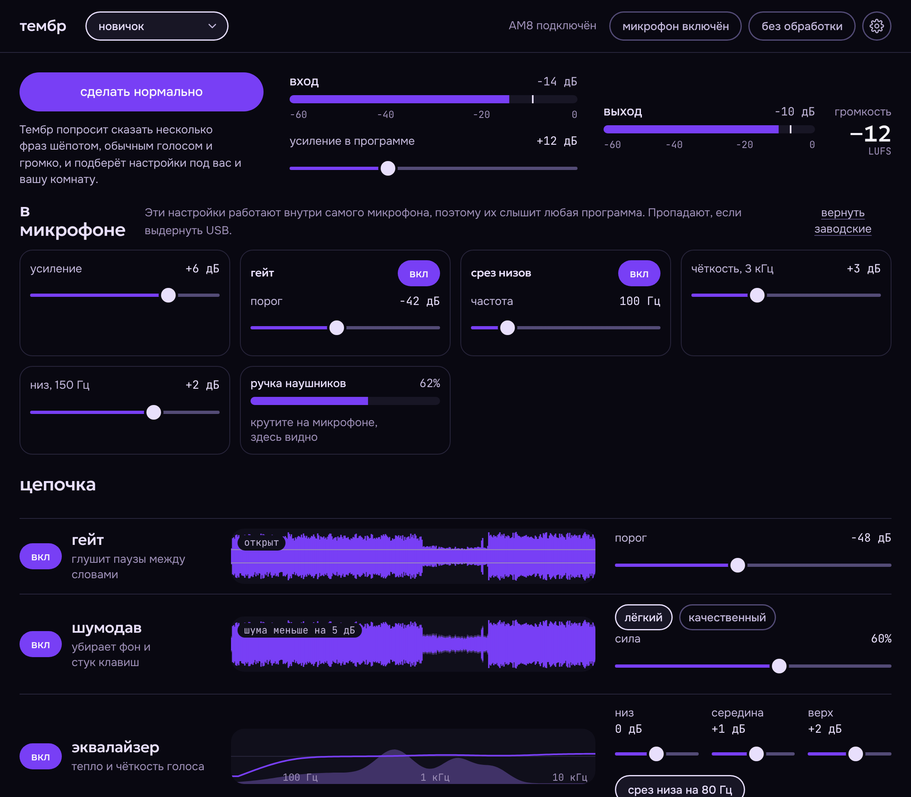
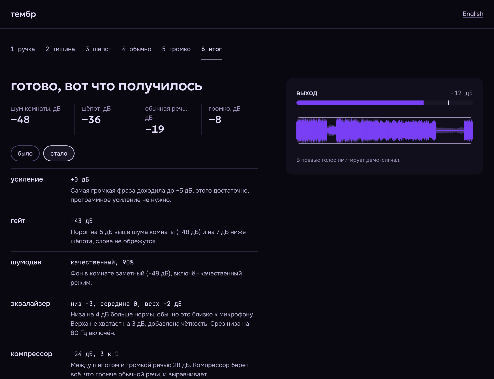

<p align="right"><a href="README.md">English</a> · Русский</p>

<p align="center">
  
</p>

**тембр** собирает звук микрофона Fifine AM8 в одном окне на Windows: собственные усиление, гейт и эквалайзер микрофона, затем шумодав, компрессор и лимитер в программе, пресеты под стрим, закадр и созвон, а также мастер калибровки, который подбирает настройки по вашему голосу и комнате. Обработанный звук уходит в Discord, OBS и Zoom через виртуальный кабель, запускать OBS ради этого не нужно.

*Voice chain for the Fifine AM8 microphone on Windows: gate, noise suppression, EQ, compressor, limiter, presets and a calibration wizard. Beta 1.*

## Зачем это нужно

У AM8 нет собственного софта. Усиление, мьют и подсветка живут на корпусе, а всё остальное, от гейта до компрессора, приходится собирать вручную в OBS или Voicemeeter, и новичок в этом теряется. Тембр заменяет эту сборку одним окном, где у каждого шага есть живая картинка сигнала и понятное название, а «сделать нормально» подбирает значения за вас.

## Что умеет

- **Внутри микрофона (новое в 0.2).** У AM8 есть собственный процессор сигнала, и Тембр говорит с ним по USB-каналу управления: усиление, гейт, срез низов, чёткость и низкий шельф, всё на главном экране. Эти настройки действуют в любой программе, с виртуальным кабелем или без него. Ручку наушников на корпусе программа читает вживую. Каждая запись перечитывается и проверяется.
- **Цепочка обработки.** Гейт, шумодав на RNNoise, эквалайзер, компрессор, лимитер. На каждой дорожке видно сигнал после этого шага на фоне исходного.
- **Пресеты в выпадающем списке.** Четыре пресета для задач (новичок, стрим, закадр, созвон), ваш «мой» и семь голосов: тёплый эфир, глубокий, яркий подкаст, объёмный, радио, робот и высокий. Любой ползунок можно поправить руками, а «вернуть пресет» откатывает правки.
- **Характер голоса.** Сдвиг высоты, тепло (мягкое насыщение), объём (хор), радио-полоса и робот на кольцевой модуляции: всё на одной дорожке и всё на ползунках.
- **Программное усиление.** AM8 динамический и тихий, поэтому Тембр сам добавляет недостающий уровень, до +36 дБ. Размер усиления считает калибровка.
- **Мастер калибровки.** Шесть шагов: проверка громкости, тишина в комнате, шёпот, обычная речь, громко, итог. Он записывает ваши настоящие фразы, ставит усиление в микрофон и проигрывает «было» и «стало» на одной и той же записи, чтобы разницу можно было услышать. Каждое значение в итоге объяснено.
- **Работает в фоне.** Иконка в трее, автозапуск вместе с Windows, глобальная горячая клавиша для мьюта, «без обработки» одним нажатием.
- **Вывод в программы.** Звук идёт в виртуальный кабель VB-Cable, в Discord, OBS или Zoom выбирается `CABLE Output`.
- **Русский и английский.** Язык интерфейса берётся из системы и переключается в настройках, на экране первого запуска и в мастере. Меню в трее переключается вместе с ним.
- **Лёгкий и локальный.** Установщик около 2 МБ, модель шумодава около 85 КБ. Звук обрабатывается на компьютере, в сеть ничего не отправляется.

## Как это выглядит

Скриншоты сняты на демо-сигнале, поэтому цифры на них только показывают, как выглядит интерфейс.





## Установка

1. Поставьте [VB-Cable](https://vb-audio.com/Cable/) и перезагрузите компьютер.
2. Скачайте `Timbre_*_x64-setup.exe` из [последнего релиза](../../releases/latest) (предварительные версии лежат в разделе [Releases](../../releases)).
3. Запустите `Timbre_*_x64-setup.exe`. Установщик не требует прав администратора. SmartScreen предупредит о неизвестном издателе: «Подробнее», «Выполнить в любом случае», потому что установщик пока без подписи.
4. В Discord, OBS или Zoom выберите микрофоном `CABLE Output`, в тембре нажмите «сделать нормально».

## Статус: бета 1 (0.2.0)

Ядро покрыто тестами на синтетическом сигнале, приложение собирается под Windows на GitHub Actions и проверено на одном настоящем AM8. Ожидаемы шероховатости:

- Настройки внутри микрофона живут в его памяти: переживают закрытие Тембра и сбрасываются, если выдернуть USB. Кнопку mute и RGB-подсветку AM8 программа не трогает: mute намеренно, а подсветка по USB на этой прошивке недоступна.
- Аналоговую ручку усиления программа прочитать не может, читается только ручка наушников.
- Подавление шума оценено на немногих живых голосах. Режим «качественный» пока использует тот же RNNoise, подключение DeepFilterNet запланировано.
- Целевая кривая для автонастройки эквалайзера прикидочная и подбирается на живых голосах (`src/js/native.js`, константы `TARGET` и `CAUTION`).
- Сдвиг высоты сделан простым гранулярным методом: хорош до ±5 полутонов, дальше слышна «дрожь».
- Громкость показывается в LUFS без калибровки тракта, как ориентир.

Нашли проблему: откройте настройки, нажмите «скопировать отчёт» и вставьте его в обращение. В отчёте список звуковых устройств и, для AM8, выгрузка его USB-интерфейсов управления и текущих внутренних настроек, только чтение.

## Типографика

Три семейства, два начертания и одна шкала, чтобы каждый уровень интерфейса читался с первого взгляда. Размеры идут по шкале 1,2 от 16 px, начертания только 400 и 500, а измеренные значения (дБ, Гц) всегда моноширинные.

| Роль | Размер | Шрифт | Где используется |
| --- | --- | --- | --- |
| Display | 33 px | Geologica 500 | заголовки страниц и мастера |
| Figure | 28 px | Geologica 500 | одна крупная цифра, громкость |
| Title | 23 px | Geologica 500 | заголовки разделов, цитаты, цифры итога |
| Section | 19 px | Geologica 500 | названия дорожек и шагов, логотип |
| Body | 16 px | Onest 400, 500 | текст, подсказки, кнопки |
| Label | 14 px | Onest 400, 500 | пояснения, подписи полей, таблетки |
| Micro | 12 px | JetBrains Mono 400 | шкалы, показания дорожек, единицы |

Роли описаны в `src/tokens.css` как `--fs-*`. Баннер строится так же, по шкале 1,25: заголовок 61 px, логотип 31 px, подзаголовок 25 px и текст 20 px.

## Сборка из исходников

Нужны Rust, Node 22 и на Windows Visual Studio Build Tools.

```
npm ci
cargo test -p timbre-dsp --release
npm run build
```

Установщик появится в `target/release/bundle/nsis`. На GitHub то же самое делает `.github/workflows/build.yml` при каждом пуше в `main`.

## Устройство репозитория

| Папка | Что внутри |
| --- | --- |
| `crates/timbre-dsp` | Цепочка обработки на Rust без привязки к окну, 18 тестов |
| `src-tauri` | Приложение на Tauri: захват (cpal, WASAPI), вывод в кабель, трей, горячая клавиша, автозапуск и `am8.rs`, канал с белым списком к собственному процессору микрофона |
| `src` | Интерфейс на HTML, CSS и JS. Вне Tauri работает на демо-сигнале, внутри `js/native.js` подключает реальный движок |
| `preview` | Интерфейс одним файлом для просмотра в браузере, собирается `node build-preview.mjs` |
| `docs` | Баннеры и скриншоты для README, исходники баннеров в HTML |

## Лицензии

Шрифты Geologica, Onest и JetBrains Mono распространяются по SIL OFL. Шумодав RNNoise подключён через крейт `nnnoiseless`. Протокол управления AM8 (MVsilicon ACP через вендорский HID-интерфейс) разобрал проект [Austrum-lab/fifine-am8](https://github.com/Austrum-lab/fifine-am8) (MIT), с опорой на [dank0i/sc3](https://github.com/dank0i/sc3); в Тембре своя реализация, и она использует только команды чтения и записи параметров, которые они описали как безопасные. VB-Cable устанавливается пользователем отдельно по условиям VB-Audio. Сам Тембр распространяется по [лицензии MIT](LICENSE).
